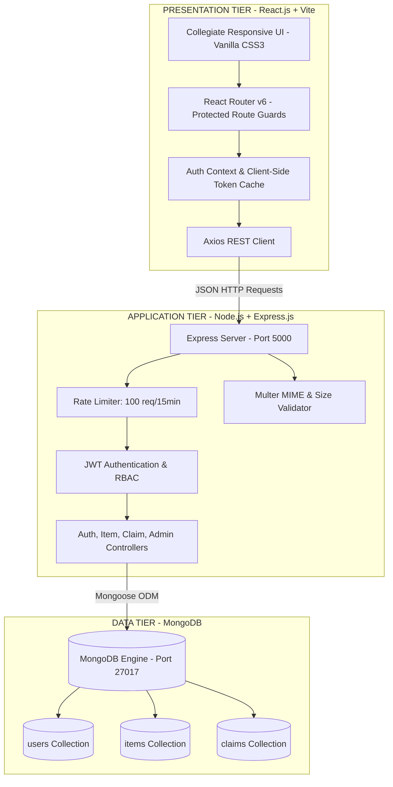
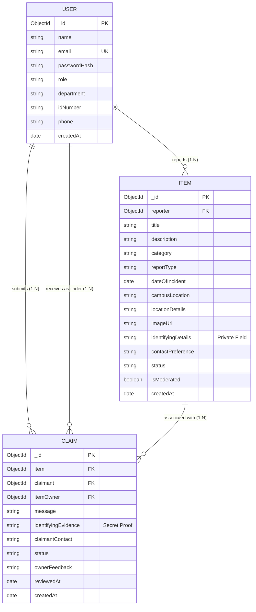

<div align="center" style="border: 2px solid #1e3a8a; border-radius: 12px; padding: 28px 20px; margin-bottom: 30px; background-color: #f8fafc;">

# CAMPUS LOST & FOUND PORTAL
### A Centralized, Privacy-Preserving Web Application for University Belongings Recovery

<br/>

**A MINI-PROJECT REPORT**  
*Submitted in partial fulfillment of the requirements for the degree of*  
**Bachelor of Technology in Computer Science & Engineering**

<br/>

---

<br/>

### **Submitted By:**
**Varuni Dhurvey**  
Department of Computer Science & Engineering  

<br/>

| **Academic Year** | **Course / Subject** | **Technology Stack** | **Testing Verification** |
| :---: | :---: | :---: | :---: |
| **2025 – 2026** | Full Stack Web Development | MERN (Mongo, Express, React, Node) | **21 / 21 Tests Passed (100%)** |

<br/>

---

**Academic Year: 2025 – 2026**

</div>

<div style="page-break-after: always;"></div>

---

## **Certificate of Approval & Student Declaration**

### **Student Declaration**
> I hereby declare that the mini-project entitled **"Campus Lost & Found Portal"** submitted by me for the course **Full Stack Web Development** is a bona fide record of original engineering work carried out by me. All resources, libraries, and design patterns utilized in this implementation have been appropriately cited.

<br/>

**Date:** 23rd October 2026  
**Place:** Campus Engineering Center  

<br/>

<table width="100%" style="border: none;">
  <tr>
    <td width="50%" align="left">
      ___________________________________<br/>
      <strong>Varuni Dhurvey</strong><br/>
      <em>Student (Candidate)</em>
    </td>
    <td width="50%" align="right">
      ___________________________________<br/>
      <strong>Internal Project Guide / Mentor</strong><br/>
      <em>Department of Computer Science & Eng.</em>
    </td>
  </tr>
</table>

<br/>

---

<div style="page-break-after: always;"></div>

## **Executive Metrics Summary**

```
┌────────────────────────┬────────────────────────┬────────────────────────┬────────────────────────┐
│     TEST COVERAGE      │   DATABASE SCHEMAS     │     AUTHENTICATION     │     API ENDPOINTS      │
│  21 / 21 Passed (100%) │   3 Linked Collections │  Stateless JWT + RBAC  │  18 RESTful Endpoints  │
└────────────────────────┴────────────────────────┴────────────────────────┴────────────────────────┘
```

---

## **Table of Contents**

1. [Abstract](#1-abstract)
2. [Motivation & Background](#2-motivation--background)
3. [Problem Statement](#3-problem-statement)
4. [System Objectives & Scope](#4-system-objectives--scope)
5. [User Personas & Role Matrix](#5-user-personas--role-matrix)
6. [3-Tier System Architecture](#6-3-tier-system-architecture)
7. [Entity-Relationship (ER) Modeling](#7-entity-relationship-er-modeling)
8. [Database Schema Specifications](#8-database-schema-specifications)
9. [Data Flow Diagrams (DFD)](#9-data-flow-diagrams-dfd)
10. [RESTful API Endpoint Directory](#10-restful-api-endpoint-directory)
11. [Privacy & Security Implementations](#11-privacy--security-implementations)
12. [Testing, Verification & Quality Assurance](#12-testing-verification--quality-assurance)
13. [Hardware & Software Specifications](#13-hardware--software-specifications)
14. [Conclusion & Future Roadmap](#14-conclusion--future-roadmap)
15. [Deliverables & Repository Layout](#15-deliverables--repository-layout)

---

<div style="page-break-after: always;"></div>

## 1. Abstract

Misplacing personal property is a chronic problem across collegiate campuses. Students, faculty, and administrative staff routinely lose items ranging from smart student identity cards, scientific calculators, and notebooks to high-value laptops, wireless earphones, keys, and wallets. Existing informal channels—such as broadcast WhatsApp groups, physical bulletin boards, and security guard inquiries—suffer from fragmentation, zero auditability, serious privacy exposure, and risks of fraudulent ownership claims.

The **Campus Lost & Found Portal** is an end-to-end full-stack web application designed to resolve these inefficiencies. Engineered using **React.js (Frontend)**, **Node.js & Express.js (Backend)**, and **MongoDB (Database)**, the application provides an authenticated, role-based platform where campus members can report lost belongings, list found items, and claim recovered property through a privacy-preserving verification mechanism. Identifying secrets (such as serial numbers or custom engravings) remain shielded from the public feed and are revealed only to verified owners and moderators. An administrative dashboard provides real-time institutional recovery metrics, listing moderation, and user oversight.

---

## 2. Motivation & Background

Higher education campuses function as sprawling mini-cities with high foot traffic through lecture halls, laboratories, dining halls, libraries, and athletic grounds. In this environment, misplaced belongings are unavoidable.

### Pitfalls of Legacy Recovery Systems:
- **Noise & Fragmentation:** Instant messaging channels (WhatsApp/Telegram) bury loss reports beneath casual social chatter within hours.
- **Privacy Vulnerabilities:** Students often post private phone numbers and hostel addresses publicly, risking harassment and opportunistic scams.
- **Absence of Proof:** In the absence of structured claim evidence, any claimant can falsely allege that a found item belongs to them.
- **Zero Institutional Metrics:** Campus administrators have no means to audit recovery rates or identify recurring lost-and-found hotspots.

> [!NOTE]
> **Core Engineering Rationale:** The system addresses these failures by establishing a structured verification cycle: **Report ➔ Search ➔ Secure Claim ➔ Proof Review ➔ Handover ➔ Automatic Resolution**.

---

## 3. Problem Statement

> **"To engineer a secure, responsive, and privacy-preserving campus lost-and-found management platform that enables university members to catalog, search, claim, and safely recover lost property with verifiable proof, database-level privacy protection, and administrative oversight."**

---

<div style="page-break-after: always;"></div>

## 4. System Objectives & Scope

### 4.1. Functional Objectives
- **Centralized Catalog:** Maintain an indexed, searchable directory of all lost and found belongings across campus facilities.
- **Multi-Parameter Search:** Enable real-time keyword search alongside filtering by category, campus zone, incident date, and recovery status.
- **Privacy-Preserving Field Masking:** Enforce database-level projection that hides sensitive identifying details (`identifyingDetails`) from unauthenticated or unrelated users.
- **Two-Way Claim Verification:** Require claimants to provide distinguishing evidence that the original finder evaluates before approving handover.
- **Administrative Moderation:** Provide role-restricted dashboards for real-time recovery analytics, content flagging, and listing cleanup.

### 4.2. Non-Functional Objectives
- **Data Integrity:** Enforce strict foreign-key referencing and cascade-delete routines to prevent orphaned records.
- **Responsive Usability:** Deliver an intuitive, college-themed interface functioning smoothly across mobile, tablet, and desktop viewports.
- **Cryptographic Security:** Hash passwords using `bcryptjs` (10 rounds) and enforce signed JWT tokens for protected route access.

---

## 5. User Personas & Role Matrix

The platform implements Role-Based Access Control (RBAC) across four user tiers:

| Role | User Persona | Access Scope | Key System Actions |
| :--- | :--- | :---: | :--- |
| **Student** | Campus undergraduates & postgraduates | Private | Report lost/found items, upload images, submit ownership claims, track claim status. |
| **Faculty** | Professors, lecturers & lab instructors | Private | Report items found in classrooms/labs, designate safe department handover points. |
| **Staff** | Security guards & facility desk staff | Private | Act as official physical drop-off hubs, verify student credentials during pickup. |
| **Admin** | Campus IT / Student Affairs evaluators | Full Admin | System-wide recovery metrics, item moderation, user account oversight, spam removal. |

---

<div style="page-break-after: always;"></div>

## 6. 3-Tier System Architecture

The project is structured according to the classic **3-Tier Client-Server Architecture**:



### Architectural Breakdown:
1. **Presentation Tier (Frontend):** React 18 single-page application bundled with Vite. Styled with a custom CSS3 design system (Flexbox, CSS Grid, CSS Variables) in navy (`#0f172a`, `#1e3a8a`) and emerald (`#059669`).
2. **Application Tier (Backend):** Node.js and Express.js RESTful API structured into modular controllers, routes, and middleware.
3. **Data Tier (Database):** MongoDB managed through Mongoose Object Data Modeling (ODM) with indexes on search and lookup fields.

---

<div style="page-break-after: always;"></div>

## 7. Entity-Relationship (ER) Modeling

The database schema connects three primary entities via MongoDB `ObjectId` references:



---

## 8. Database Schema Specifications

### 8.1. `users` Collection
| Field Name | Type | Key | Validation / Constraints | Description |
| :--- | :---: | :---: | :--- | :--- |
| `_id` | ObjectId | PK | Auto-generated | Unique user identifier |
| `name` | String | — | Required, Trimmed | Full name of student or faculty |
| `email` | String | UK | Required, Lowercase, Unique | University institutional email address |
| `passwordHash` | String | — | Required | Salted password hash (`bcryptjs`, 10 rounds) |
| `role` | String | — | Enum: `['student','faculty','staff','admin']` | User privilege level |
| `department` | String | — | Optional, Trimmed | Academic department (e.g. CSE, ECE) |
| `idNumber` | String | — | Optional, Trimmed | College roll number or faculty ID |
| `phone` | String | — | Optional, Trimmed | Direct phone number |
| `createdAt` | Date | — | Default: `Date.now` | Account creation timestamp |

### 8.2. `items` Collection
| Field Name | Type | Key | Validation / Constraints | Description |
| :--- | :---: | :---: | :--- | :--- |
| `_id` | ObjectId | PK | Auto-generated | Unique item identifier |
| `reporter` | ObjectId | FK | Ref: `'User'`, Required | User who filed the report |
| `title` | String | — | Required, Max 120 chars | Clear item headline |
| `description` | String | — | Required, Max 1000 chars | Public narrative description |
| `category` | String | — | Enum: `Electronics`, `Books`, `IDs`, etc. | Item classification category |
| `reportType` | String | — | Enum: `['lost', 'found']` | Type of listing |
| `dateOfIncident` | Date | — | Required, Defaults to now | Date when item was lost or found |
| `campusLocation` | String | — | Enum: 10 campus zones | Zone (Library, Cafeteria, Sports, etc.) |
| `locationDetails` | String | — | Optional, Max 200 chars | Specific desk, table, or room |
| `imageUrl` | String | — | Optional relative URL | Path to uploaded image (`/uploads/...`) |
| `identifyingDetails`| String | — | `select: false` (Hidden) | Secret proof hidden from public view |
| `contactPreference`| String | — | Enum: `['email','phone','handover_security']` | Preferred return channel |
| `status` | String | — | Enum: `['lost','found','claim_pending','resolved']` | Active lifecycle status |
| `isModerated` | Boolean| — | Default: `false` | Administrator moderation flag |

### 8.3. `claims` Collection
| Field Name | Type | Key | Validation / Constraints | Description |
| :--- | :---: | :---: | :--- | :--- |
| `_id` | ObjectId | PK | Auto-generated | Unique claim request identifier |
| `item` | ObjectId | FK | Ref: `'Item'`, Required | Target item being claimed |
| `claimant` | ObjectId | FK | Ref: `'User'`, Required | User filing the claim |
| `itemOwner` | ObjectId | FK | Ref: `'User'`, Required | User who reported the found item |
| `message` | String | — | Required, Max 500 chars | Personal message to the finder |
| `identifyingEvidence`| String| — | Required, Max 1000 chars | Verifiable ownership evidence |
| `claimantContact` | String | — | Required | Email or phone for return handover |
| `status` | String | — | Enum: `['pending','approved','rejected','completed']` | Resolution status |
| `ownerFeedback` | String | — | Optional | Finder's notes upon review |
| `reviewedAt` | Date | — | Optional | Timestamp when claim was reviewed |

---

<div style="page-break-after: always;"></div>

## 9. Data Flow Diagrams (DFD)

### 9.1. Level 0 DFD (Context Level)
```
  ┌──────────────────┐                                   ┌───────────────────────┐
  │   Campus Member  │                                   │  Administrator / HOD  │
  │ (Student/Faculty)│                                   └───────────┬───────────┘
  └────────┬─────────┘                                               │
           │ 1. Credentials, Reports, Claims                         │ 5. Audit & Moderation
           ▼                                                         ▼
  ┌──────────────────────────────────────────────────────────────────────────────┐
  │                  CAMPUS LOST & FOUND PORTAL (System 0.0)                     │
  └──────────────────────────────────────┬───────────────────────────────────────┘
                                         │
                                         ▼ 2. Read / Write Transactions
                              ┌────────────────────┐
                              │  MongoDB Database  │
                              └────────────────────┘
```

### 9.2. Level 1 DFD (Subsystem Workflows)

```
[ User ] ────▶ (1.0 Authenticate) ───────────▶ [ Token Issued & Cached ]
   │
   ├─────────▶ (2.0 Catalog Item) ───────────▶ [ Item Stored + Photo Saved ]
   │
   ├─────────▶ (3.0 Search & Filter) ────────▶ [ Masked Listings Returned ]
   │
   ├─────────▶ (4.0 Submit Claim Proof) ─────▶ [ Claim Created: Pending ]
   │                                                    │
   │                                                    ▼
   └─────────▶ (5.0 Review & Handover) ──────▶ [ Finder Approves ➔ Item: Resolved ]
```

---

<div style="page-break-after: always;"></div>

## 10. RESTful API Endpoint Directory

### 10.1. Authentication (`/api/auth`)
| Method | Endpoint | Access | Purpose |
| :---: | :--- | :---: | :--- |
| `POST` | `/api/auth/register` | Public | Register new campus member account. |
| `POST` | `/api/auth/login` | Public | Authenticate credentials & return JWT. |
| `POST` | `/api/auth/logout` | Public | Invalidate active client session. |
| `GET` | `/api/auth/me` | Private | Retrieve authenticated profile. |
| `PUT` | `/api/auth/profile` | Private | Update contact number, department, or ID. |

### 10.2. Item Management (`/api/items`)
| Method | Endpoint | Access | Purpose |
| :---: | :--- | :---: | :--- |
| `GET` | `/api/items` | Public | Search and browse active listings. |
| `GET` | `/api/items/:id` | Public/Auth | View item details (reveals secret proof only to owner/admin). |
| `GET` | `/api/items/mine` | Private | Retrieve all items reported by current user. |
| `POST` | `/api/items` | Private | Create a new lost/found report with photo upload. |
| `PUT` | `/api/items/:id` | Private (Owner) | Update an owned item report. |
| `PATCH`| `/api/items/:id/status` | Private (Owner) | Toggle status (e.g., mark resolved). |
| `DELETE`| `/api/items/:id` | Private (Owner/Admin)| Delete listing and cascade-delete all related claims. |

### 10.3. Claims & Recovery (`/api/claims`)
| Method | Endpoint | Access | Purpose |
| :---: | :--- | :---: | :--- |
| `POST` | `/api/claims` | Private | Submit ownership claim with secret evidence. |
| `GET` | `/api/claims/mine` | Private | View claims submitted by current user. |
| `GET` | `/api/claims/received` | Private | View claims filed on user's found listings. |
| `PATCH`| `/api/claims/:id/status`| Private (Finder) | Approve/reject claim; auto-resolves item upon approval. |

### 10.4. Administration (`/api/admin`)
| Method | Endpoint | Access | Purpose |
| :---: | :--- | :---: | :--- |
| `GET` | `/api/admin/stats` | Admin Only | View institutional stats & calculated recovery rates. |
| `GET` | `/api/admin/items` | Admin Only | View all reports with moderation flags. |
| `PATCH`| `/api/admin/items/:id/moderate` | Admin Only | Flag suspicious listings or attach moderator notes. |
| `DELETE`| `/api/admin/items/:id` | Admin Only | Remove fraudulent or inappropriate reports. |
| `GET` | `/api/admin/users` | Admin Only | Audit registered campus accounts. |

---

<div style="page-break-after: always;"></div>

## 11. Privacy & Security Implementations

```
┌──────────────────────────────────────────────────────────────────────────────────┐
│                             SECURITY ARCHITECTURE                                │
├──────────────────────────┬──────────────────────────┬────────────────────────────┤
│   DATABASE PRIVACY       │    DATA SANITIZATION     │     ACCESS CONTROL         │
│   identifyingDetails     │    Multer MIME Filtering │     JWT HMAC-SHA256        │
│   hidden with            │    5MB Upload Ceiling    │     bcrypt (10 Rounds)     │
│   select: false          │    express-rate-limit    │     Strict Owner/Admin     │
└──────────────────────────┴──────────────────────────┴────────────────────────────┘
```

1. **Database-Level Field Masking (`select: false`):**
   The `identifyingDetails` field in the `Item` schema is excluded from default queries. General browsers only see public descriptions. Only when the authenticated user matches `item.reporter` or holds an `admin` role is this private field explicitly projected.
2. **Password Cryptography:**
   Passwords are never stored in plaintext. They are encrypted using `bcryptjs` with **10 salt rounds** prior to persistence.
3. **Stateless JWT Authorization:**
   Authentication relies on signed Bearer JWT tokens. Protected routes verify token validity and enforce role privileges via middleware.
4. **Brute-Force & Denial-of-Service Defense:**
   The backend applies `express-rate-limit`, limiting incoming requests to 100 requests per 15 minutes per IP address to safeguard against brute-force attacks.
5. **Secure Media Uploads:**
   Image uploads are verified against strict MIME types (`image/jpeg`, `image/png`, `image/webp`) with a **5MB size ceiling**. Filenames are sanitized with cryptographic timestamp prefixes.
6. **Cross-Origin Protection:**
   CORS is locked to the explicit client development and production origins.

---

<div style="page-break-after: always;"></div>

## 12. Testing, Verification & Quality Assurance

To ensure software reliability, an automated integration test suite (`server/tests/api.test.js`) executes 21 end-to-end verification tests against the live database:

```text
========================================================
  Campus Lost & Found Portal - Automated API Test Suite 
========================================================

[1] Testing System Health Check...
  [PASS] GET /api/health returns 200 and healthy status

[2] Testing Authentication...
  [PASS] POST /api/auth/login admin login succeeds and returns JWT
  [PASS] POST /api/auth/register creates new student and returns JWT
  [PASS] GET /api/auth/me returns authenticated student profile

[3] Testing Item Management...
  [PASS] GET /api/items returns list of active campus items
  [PASS] GET /api/items returned total count of 6 seeded items
  [PASS] GET /api/items with search and reportType filters works accurately
  [PASS] POST /api/items successfully creates new item report
  [PASS] GET /api/items/:id retrieves correct item details
  [PASS] GET /api/items/:id correctly identifies current user as owner
  [PASS] Owner receives private identifyingDetails
  [PASS] PUT /api/items/:id updates owned item fields
  [PASS] Unauthorized PUT /api/items/:id without token is rejected with 401

[4] Testing Claims & Recovery Workflow...
  [PASS] Found seeded found item to test claim submission
  [PASS] POST /api/claims successfully creates pending claim
  [PASS] GET /api/claims/mine returns claimant submitted claims

[5] Testing Role-based Access Control (RBAC)...
  [PASS] Regular student accessing /api/admin/stats is blocked with 403 Forbidden

[6] Testing Administrator Moderation...
  [PASS] GET /api/admin/stats returns real database aggregates
  [PASS] Admin stats returns calculated recovery rate (14%)
  [PASS] PATCH /api/admin/items/:id/moderate successfully updates moderation note

[7] Testing Deletion & Cleanup...
  [PASS] DELETE /api/items/:id deletes owned item report

========================================================
  Tests Passed: 21 | Tests Failed: 0 (100% Pass Rate)
========================================================
```

---

## 13. Hardware & Software Specifications

### Software Specifications
- **Operating System:** Windows 10 / 11, macOS, or Linux
- **Runtime Environment:** Node.js v18.0.0 or higher (Tested on Node v24.19.0)
- **Database Server:** MongoDB Community Edition v6.0+ or MongoDB Atlas Cloud
- **Web Browser:** Google Chrome, Mozilla Firefox, Microsoft Edge, or Safari
- **Package Manager:** npm v9+

### Hardware Specifications
- **Processor:** Intel Core i3 / AMD Ryzen 3 or higher
- **RAM:** Minimum 4 GB (8 GB recommended for simultaneous server and client runtime)
- **Storage:** 500 MB free hard disk space
- **Network Interface:** Localhost network stack

---

<div style="page-break-after: always;"></div>

## 14. Conclusion & Future Roadmap

### Conclusion
The **Campus Lost & Found Portal** replaces disorganized notice boards and chaotic messaging channels with a modern, database-driven web platform. By combining a modern responsive React interface, a robust Express REST API, privacy-protecting field masking, and a verifiable claim-handover cycle, the system demonstrates how full-stack web engineering can solve everyday campus operational challenges.

### Future Roadmap
1. **AI Visual Similarity Matching:** Integrate computer vision embeddings to compare uploaded photos of lost items against newly found items and suggest instant matches.
2. **Interactive Campus Geo-Map:** Deploy an interactive Leaflet/OpenStreetMap visualizer showing item loss clusters across campus facilities.
3. **Instant SMS & Webhook Alerts:** Implement automated notifications (via Twilio/Web Push) when a claim is submitted on an item.
4. **Printable QR-Code Smart Labels:** Generate printable unique QR codes that students can stick to calculators and chargers for direct scan-to-report handovers.

---

## 15. Deliverables & Repository Layout

```
Campus Lost & found Portal/
├── database/                             # Database Exports & Guides
│   ├── users.json                        # Exported users collection (4 records)
│   ├── items.json                        # Exported items collection (6 records)
│   ├── claims.json                       # Exported claims collection (2 records)
│   ├── campus_lost_found_database.json   # Full consolidated database JSON
│   └── DATABASE_SETUP_GUIDE.md           # Step-by-step Atlas & Compass upload guide
├── client/                               # Frontend React Application
│   ├── src/
│   │   ├── components/                   # Navbar, Footer, ItemCard, FilterBar, ClaimModal
│   │   ├── context/                      # AuthContext.jsx (JWT state management)
│   │   ├── pages/                        # Home, Browse, Details, Report, Admin, Dashboard
│   │   ├── services/                     # Axios API service handlers
│   │   └── styles/                       # index.css (Complete CSS3 Design System)
│   └── package.json
├── server/                               # Backend Express & Node API
│   ├── config/                           # db.js (Mongoose connection)
│   ├── controllers/                      # itemController, claimController, authController, adminController
│   ├── middleware/                       # authMiddleware, uploadMiddleware, errorMiddleware
│   ├── models/                           # User.js, Item.js, Claim.js
│   ├── routes/                           # API route definitions
│   ├── seed/                             # seed.js, exportDB.js, importDB.js
│   ├── tests/                            # api.test.js (Automated 21-test suite)
│   ├── uploads/                          # Statically served uploaded item images
│   ├── app.js                            # Express app configuration & middleware
│   └── server.js                         # Server entry point
├── Campus_Lost_and_Found_API.postman_collection.json # Complete Postman collection
├── PROJECT_REPORT.md                     # Comprehensive Academic Project Report
├── VIVA_PREPARATION.md                   # 25+ Evaluator Viva Questions & Answers
├── run.js                                # Single-command dual server launcher
├── run-project.bat                       # 1-Click Windows launcher
└── README.md                             # Comprehensive technical documentation
```

---

<br/>

<div align="center">
  <strong>© 2026 Varuni Dhurvey • Campus Lost & Found Portal • All Rights Reserved</strong>
</div>
